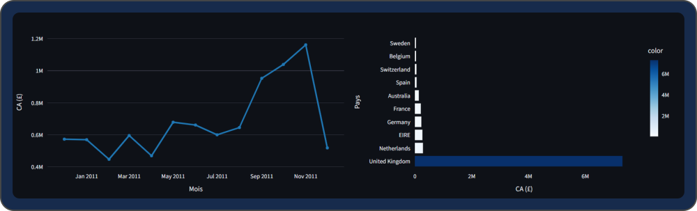
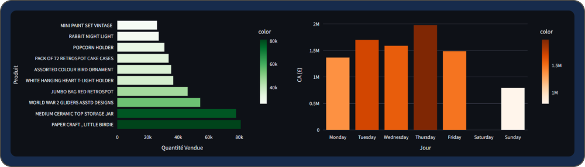
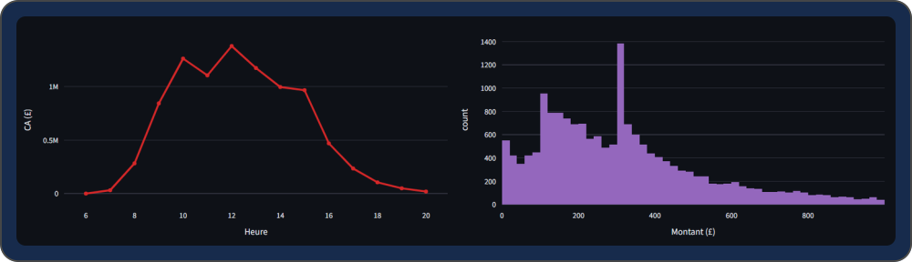

<a href="README.md">Version française</a>

  

  
  
  

  
  
  
  
  

  <a href="https://linkedin.com/in/kadi-bagayoko">LinkedIn</a> · <a href="mailto:kadibaga22@gmail.com">kadibaga22@gmail.com</a>

> The visuals and the availability chips are in French; the text below is translated.

## ◆ About

I design and build Data & AI solutions.

- **Role**: Data & AI Solutions Builder
- **Education**: Bachelor 3 in Data & Artificial Intelligence, ECE Paris
- **Open to**: work-study placement 2026-2027, 3 weeks at the company / 2 weeks at school
- **I build**: dashboards, custom systems, automation, machine learning, AI assistants

I don't stop at analysis: I build complete solutions, from the business need to deployment.

Portfolio: link coming soon

  

## ◆ Experience

| Year | Organisation | Role | What I did |
|---|---|---|---|
| 2026, since April | TCIM / Skills4Mind | AI part (ongoing) | Automatic classification of health data (TF-IDF + Random Forest), 82.5% accuracy. Project presentation on request. |
| 2026, April to June | Consulate of Mali | Data & Digital Innovation intern | At the Consulate of Mali, I analysed processes, made data more reliable and presented optimisation recommendations to the Consul, which led to a 50% reduction in users' trips. *(estimate)* |
| 2025, June to September | Femmes Audacieuses | Data analysis & Business | KPIs and reporting for management: +30% engagement. |

## ◆ The dashboard in pictures

Real screenshots of the e-commerce dashboard (Streamlit + Plotly), cropped to the charts.

  

*Monthly revenue (December 2011 partial) and top 10 countries: the United Kingdom accounts for 82% of revenue.*

  

*Top 10 products by quantity sold and revenue by day of the week.*

  

*Revenue by hour of the day and distribution of transaction amounts.*

## ◆ Stack

**Data** 
     

**AI / ML** 
 

**Dev** 
  

**Tools** 
 

## ◆ Activity

  <picture>
    <source media="(prefers-color-scheme: dark)" srcset="https://raw.githubusercontent.com/Kadi2207/Kadi2207/output/github-snake-dark.svg">
    
  </picture>

## ◆ Contact

  

  <a href="https://linkedin.com/in/kadi-bagayoko">LinkedIn</a> · <a href="mailto:kadibaga22@gmail.com">kadibaga22@gmail.com</a> · <a href="https://github.com/Kadi2207">GitHub</a> · Portfolio: link coming soon

  

